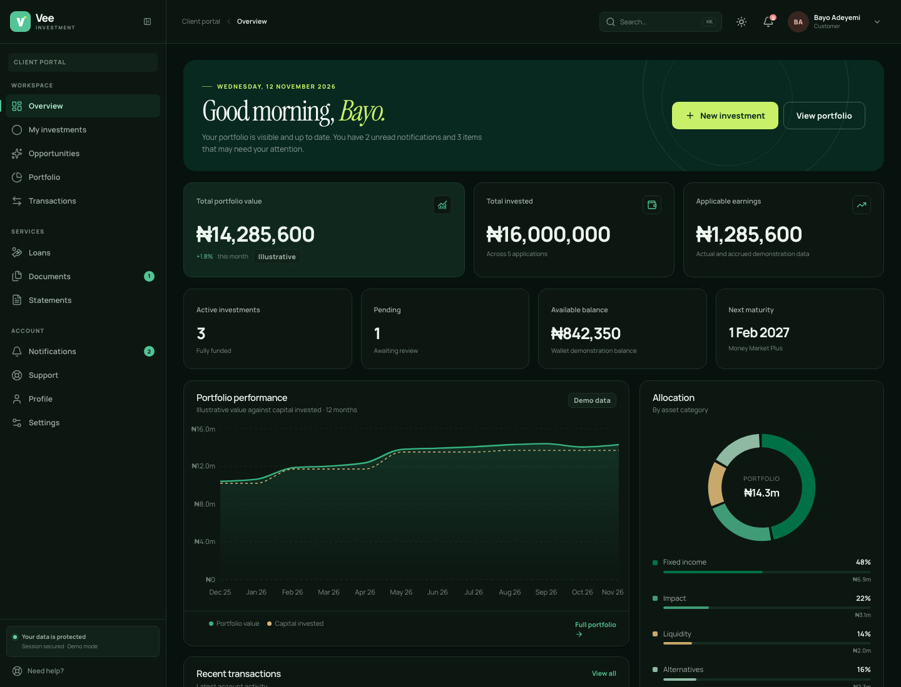
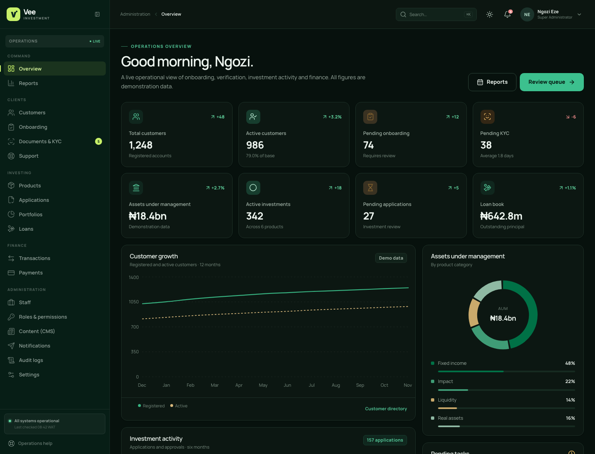

# Vee Investment — investment & wealth management platform

A complete, production-quality **frontend demonstration** of the Vee Investment platform, built on the existing project rather than from a generic template.

**Stack:** Next.js 16.4.6 · React 19.3.1 · App Router · JavaScript/JSX · CSS design tokens · Axios · Recharts · Lucide · ESLint 9


## Three connected experiences

1. **Public website** — conversion-focused homepage, product catalogue and detail pages, about, team, services, insights, FAQ, contact, careers, help and legal/trust pages.
2. **Customer portal** — portfolio overview, investments, application workflow, portfolio analytics, transactions, loans, documents, notifications, statements, support, profile and settings.
3. **Administration portal** — operations dashboard, customers, onboarding, KYC/document review, products, applications, portfolios, loans, transactions, payments, staff, RBAC, reports, support, CMS, notifications, audit logs and settings.

The interfaces are guarded by a demonstration session and role-aware navigation. **Frontend permissions are not backend authorisation.**

## Run locally

```bash
npm install
cp .env.example .env.local   # optional for mock-only mode
npm run dev
```

Open `http://localhost:3000`.

```bash
npm run lint
npm run build
npm start
```

## Demonstration accounts

| Role | Email | Password |
|---|---|---|
| Client | `bayo.adeyemi@demo.veeinvestment.com` | `Demo2026!` |
| Administrator | `admin@demo.veeinvestment.com` | `Admin2026!` |
| Compliance | `compliance@demo.veeinvestment.com` | `Compliance2026!` |

Use the account shortcuts on the login screen to fill the credentials. Passwords are never stored in browser storage.

## Key routes

- `/` — public homepage
- `/investments` and `/investments/[slug]` — product catalogue and details
- `/auth/login`, `/auth/register`, `/auth/forgot-password` — authentication
- `/onboarding` — 12-step client onboarding
- `/dashboard` — customer portal
- `/admin` — administration portal

See [`ROUTE_MAP.md`](ROUTE_MAP.md) for the full map and access model.

## Screenshots

| Public | Client portal | Administration |
|---|---|---|
|  |  |  |

More captures: [onboarding](docs/screenshots/onboarding.png), [login](docs/screenshots/login-dark.png), [customer investments](docs/screenshots/investments.png), [customers](docs/screenshots/admin-customers.png), [KYC review](docs/screenshots/admin-documents.png), [insights](docs/screenshots/insights.png), [team](docs/screenshots/team.png), [mobile homepage](docs/screenshots/home-mobile.png), [mobile dashboard](docs/screenshots/dashboard-mobile.png).

## Architecture and documentation

- [`AUDIT.md`](AUDIT.md) — complete audit of the supplied project and what changed
- [`UPGRADE_REPORT.md`](UPGRADE_REPORT.md) — dependency upgrade, breaking changes and verification
- [`IMPLEMENTATION_PROGRESS.md`](IMPLEMENTATION_PROGRESS.md) — completed work and remaining production tasks
- [`FRONTEND_ARCHITECTURE.md`](FRONTEND_ARCHITECTURE.md) — structure, theming, data layers, access model
- [`API_INTEGRATION.md`](API_INTEGRATION.md) — Django REST Framework contract and sample payloads
- [`ENVIRONMENT_SETUP.md`](ENVIRONMENT_SETUP.md) — setup, env vars, demo state and troubleshooting
- [`ROUTE_MAP.md`](ROUTE_MAP.md) — all routes, states and legacy redirects
- [`QA_REPORT.md`](QA_REPORT.md) — lint/build verification, route crawl, visual and flow QA
- [`MAINTENANCE_REPORT.md`](MAINTENANCE_REPORT.md) — latest font, accessibility, SEO and layout fixes

## Design system

- Green brand retained and expanded: `#007146`, deep forest, warm sand and lime accents.
- Full token-based light/dark/system themes with a no-flash boot script and persistence.
- Manrope UI type and Instrument Serif editorial display type.
- Shared buttons, fields, badges, tables, modals, tabs, accordions, charts, skeletons, toasts and empty/loading/error states.
- Responsive across public, auth, onboarding, client and admin shells.

## Important limitations

This is a **frontend demonstration prepared for backend integration**:

- Company information, financial figures, people, photography and product terms are illustrative sample data.
- Authentication is local-only and is not production security.
- No live payments, approvals, verification results or investments are created.
- PDF/CSV exports are browser-generated demonstration files.
- Legal and compliance content is draft and must be reviewed by qualified counsel.
- The UI currently reads from the local data repository. The Axios service adapters in `lib/services` define the future API boundary.

No claim of regulatory approval, deposit protection or guaranteed return is made or implied.
